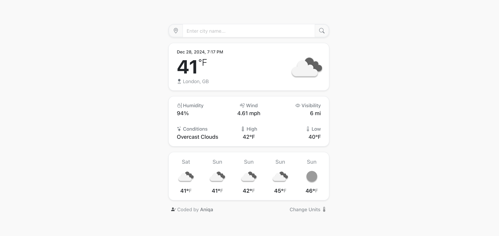

# Weather Mini

A small React weather app with current conditions and a 5-day forecast for any city or your current location.

**[Live site](https://mini.weather.aniqa.dev)** · [Full weather dashboard](https://github.com/aniqatc/weather)

<a href="https://mini.weather.aniqa.dev"></a>

<!-- TODO: retake this screenshot now that the forecast row shows five different days (this one is from before the fix and shows Sat, Sun, Sun, Sun, Sun) -->

## Tech

- React 19, bootstrapped with Create React App
- Bootstrap and Bootstrap Icons
- Axios for the OpenWeather Current Weather and 5-day Forecast APIs
- React Spinners for the loading state

## Features

- Search by city name, or use your current location
- Current temperature, conditions, high and low, humidity, wind and visibility, with the date and time
- A 5-day forecast with one reading per day
- Switch between °F and °C from the footer
- Remembers your last city and unit, starting with New York City on your first visit
- Loading and error cards, with a link to report an issue

## Design

- A single column of rounded cards, at most 500px wide on any screen
- Grayscale OpenWeather icons to keep the palette quiet

## Accessibility

- The search field and location button have screen reader labels
- Weather icons use the condition as alt text

## Project structure

- `src/App.js`: state for the city, unit, weather and forecast, and the data fetching
- `src/components/`: search, the three weather cards, loading and error cards, the footer and a shared `Card` wrapper
- `src/data/weatherService.js`: OpenWeather requests and saved preferences
- `src/data/dailyForecast.js`: turns 3-hour forecast readings into one reading per day

## Key concepts

- **Chained requests.** One `useEffect` fetches the current weather, then uses its coordinates to fetch the forecast, re-running whenever the city or unit changes.
- **One reading per day.** OpenWeather's free forecast returns a reading every 3 hours. `dailyForecast` groups them by day in the city's own time zone and keeps the one closest to noon.
- **Reusable `Card`** wraps every section, so the loading, error and weather states share one look.
- **Practicing React basics**: state, effects, props, conditional rendering and form handling.

## Setup

Requires Node 18+ and a free [OpenWeather API key](https://home.openweathermap.org/api_keys).

| Variable | Where to get it |
| --- | --- |
| `REACT_APP_API_KEY` | OpenWeather → My API keys |

```bash
git clone https://github.com/aniqatc/weather-mini.git
cd weather-mini
npm install
echo "REACT_APP_API_KEY=your_key" > .env
npm start
```

## Scripts

| Command | What it does |
| --- | --- |
| `npm start` | Dev server at http://localhost:3000 |
| `npm run build` | Production build in `build/` |

## Changelog

### October 2026

- Fixed the forecast row, which showed five 3-hour readings labeled by weekday instead of five days
- Visibility now shows km in metric

### December 2024

- Initial release
